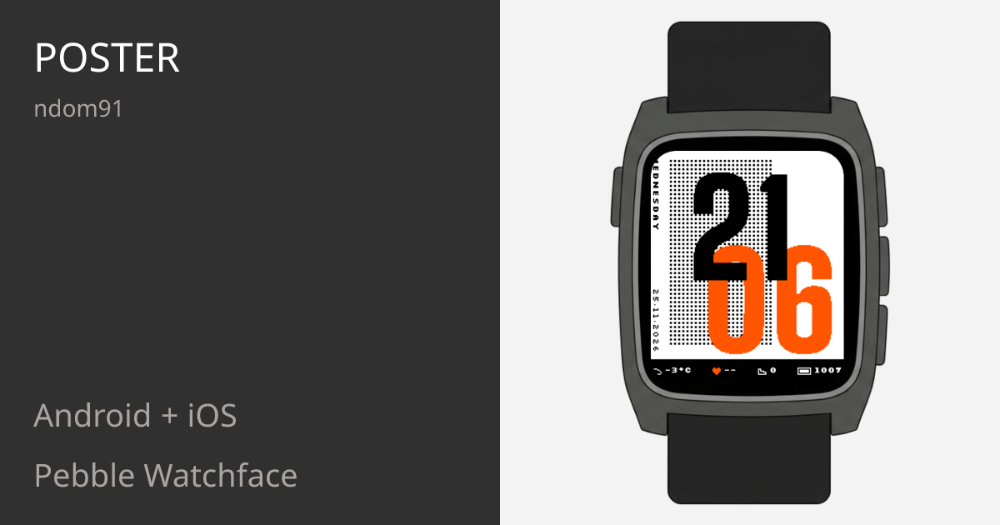

# Poster — a Pebble Time 2 watchface



Staggered, interlocking monospace digits over a halftone block, a vertical date rail and a black status strip with weather, heart rate, steps and battery. Built for the Pebble Time 2 (`emery`, 200×228, 64 colours).

## Install

Install from the store: https://apps.repebble.com/a188c39872c345cca5946edb

## What it shows

| Where | What | Source |
| --- | --- | --- |
| Digits | Hours (black) / minutes (orange), 12 or 24 h per watch setting | tick timer |
| Left rail | Weekday, date | tick timer |
| Strip | Weather icon + °C | PebbleKit JS → Open-Meteo (no API key), every 30 min |
| Strip | Heart rate | Health API (`HealthMetricHeartRateBPM`) |
| Strip | Steps today | Health API |
| Strip | Battery (green fill while charging) | battery service |

## Manual Build

```sh
uv tool install pebble-tool        # Python 3.10–3.13
pebble sdk install latest
sh tools/setup.sh                  # fetch fonts + render bitmaps (needs Pillow, or uv)
pebble build
pebble install --emulator emery    # try it in the emulator
pebble install --phone <phone-ip>  # needs Developer Connection on in the Pebble app
```

The built `build/pebble-time-2-face.pbw` can also be opened directly with the Pebble app on the phone.

If the SDK asks to convert the `wscript` to CMake, `pebble convert` does it.

## Settings

Open the watchface's settings in the Pebble app to choose:

- which of weather, heart rate, steps and battery show in the strip (it hides when all are off; one item is centred)
- °C or °F for the temperature
- the vertical date format: `25.11.2026` (DE/EU), `11/25/2026` (US), `2026-11-25` (ISO), `25 NOV 2026` or `NOV 25 2026`

The page is built with [Clay](https://github.com/pebble-dev/clay) (`src/pkjs/config.js`); `pebble build` installs it from npm.

## License

MIT
